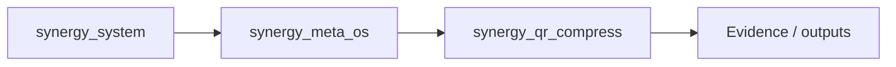
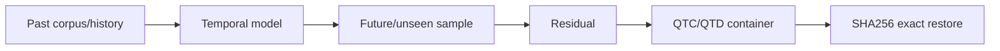

# SHTENCO QR Compress — QTC1 + QTC2 Temporal Dictionary Engine

Независимый lossless-проект для упаковки информации в QR-последовательности с temporal addressing. `Shtenco/ai_compress` не изменяется.

QTC2 развивает идеи `ai_compress`: multiple lossless engines, MDL-style routing, exact byte round-trip, SHA-256 verification и shared-model compression.

## Что нового в QTC2

### 1. QTD1 shared temporal model

Корпус обучается в общий файл `QTD1`.

Каждый sample получает временной slot:

```text
slot = unix_ns >> 20
```

Старшие биты UNIX-ns являются **адресом entry в shared model**. Младшие 20 бит содержат content-derived temporal tag.

При collision соседний свободный slot выбирается детерминированно.

### 2. Три режима QTC2

- `exact` — timestamp адресует exact entry модели, residual = 0 bytes.
- `patch` — timestamp адресует ближайший template, QR несёт только compressed residual.
- `standalone` — автоматический fallback, если модель не даёт выигрыша.

### 3. Honest 99.9999% metric

`model_coverage_percent` считается как реальная доля целевого файла, восстановленная COPY-операциями из shared temporal model.

```text
coverage = covered_model_bytes / original_bytes * 100
```

Флаг `target_99_9999_percent_met` становится `true` только если измеренная coverage >= `99.9999`.

Это **не утверждение**, что произвольный файл физически помещается в 64-битный timestamp. Timestamp является адресом внешней общей модели. Незнакомая энтропия остаётся в residual.

### 4. Residual engine

Patch format использует:

- prefix/suffix exact matching;
- byte-exact `SequenceMatcher` на малых/средних middle-regions;
- block fallback на больших regions;
- COPY/LITERAL opcodes;
- compact varints;
- exact target-size validation.

### 5. MDL codec router

Доступные lossless candidates:

- raw;
- zlib-9;
- bz2-9;
- LZMA extreme;
- Zstandard level 19;
- Brotli quality 11;
- pure-Python order-0 rANS;
- optional `GabrielHornEngine(profile="max")`, если `compression_lab` из `ai_compress` доступен в Python environment.

Для каждого кандидата выполняется encode → decode → byte equality. Побеждает минимальный operational score.

Zstd использует FSE/ANS entropy stage; отдельный `rans-o0` нужен для воспроизводимого standalone ANS baseline.

### 6. Integrity

QTC2 проверяет:

- magic + version;
- model SHA-256 (`model_id`);
- timestamp temporal slot;
- 20-bit content tag;
- template size;
- original size;
- final SHA-256;
- QR frame CRC32.

## Проверенный benchmark

Synthetic benchmark: shared model содержит 1,000,000 random bytes.

### Exact sample

```text
original:          1,000,000 bytes
QTC2 payload:              0 bytes
QTC2 container:          108 bytes
model coverage:       100.0000%
round-trip:             exact
```

### 1 byte changed from 1,000,000

```text
original:          1,000,000 bytes
covered by model:    999,999 bytes
model coverage:      99.9999%
QTC2 payload:              19 bytes
QTC2 container:           127 bytes
QTC1 container:     1,000,060 bytes
QTC2 vs QTC1:       ~99.9873% smaller
round-trip:             exact
```

Эти цифры относятся к данному controlled benchmark с общей моделью. Для произвольного нового распределения система может переключиться в `standalone`.

## Tests

Локальный suite:

```text
11 passed
```

Проверяются QTC1 regression, reordered QR frames, corruption rejection, rANS exact round-trip, deterministic QTD1 serialization, QTC2 exact timestamp-address mode, QTC2 99.9999% one-byte mutation case, wrong-model rejection и fallback для unrelated data.

## Установка

```bash
python -m pip install -e ".[dev]"
pytest -q
```

## Training temporal model

По modification timestamps файлов:

```bash
qr-compress train-model corpus/ --recursive -o corpus.qtd
```

Или через JSONL manifest с точными UNIX-ns:

```json
{"path":"samples/a.bin","unix_ns":1787990000000000000}
{"path":"samples/b.bin","unix_ns":1787990001000000000}
```

```bash
qr-compress train-model --manifest corpus.jsonl -o corpus.qtd
```

## QTC2 encode / decode

```bash
qr-compress encode2 input.bin --model corpus.qtd -o input.qtc2 --qr-dir qr_frames
qr-compress inspect2 input.qtc2 --model corpus.qtd
qr-compress decode2 input.qtc2 --model corpus.qtd -o restored.bin
```

Standalone QTC2 fallback также работает без модели:

```bash
qr-compress encode2 input.bin -o input.qtc2
qr-compress decode2 input.qtc2 -o restored.bin
```

## Python API

```python
from qr_temporal import TemporalSample, train_temporal_dictionary, pack_v2, unpack_v2

model = train_temporal_dictionary([
    TemporalSample(1787990000000000000, b"state-v1"),
])

packed = pack_v2(b"state-v2", model=model)
assert unpack_v2(packed.blob, model=model) == b"state-v2"
```

## QR transport

QTC1 и QTC2 используют общий multi-frame transport `QF1`: timestamp, frame index, frame total, payload length, CRC32 и payload. Frames могут быть просканированы не по порядку и собираются только при полном согласованном наборе.

## Benchmarks

QTC1:

```bash
python benchmark.py
python benchmark.py --random-bytes 100000
```

QTC2 shared-model benchmark:

```bash
python benchmark_qtc2.py --bytes 1000000
```

## Architecture

```text
                  SHARED QTD1 TEMPORAL MODEL
                  ┌─────────────────────────┐
corpus + UNIX-ns ─► entry / slot / sketch  │
                  └────────────┬────────────┘
                               │
                               ▼
input ─► candidate selector ─► exact / template
                               │
                 ┌─────────────┴──────────────┐
                 │                            │
             exact match                  residual patch
                 │                            │
        payload = 0 bytes          MDL codec router
                 │                            │
                 └─────────────┬──────────────┘
                               ▼
        UNIX-ns temporal address + model_id + SHA-256
                               │
                               ▼
                         QTC2 container
                               │
                               ▼
                         QF1 QR frames
```

## Information-theoretic boundary

QTC2 может сделать **QR-carried residual** крайне малым только когда encoder и decoder уже разделяют достаточно predictive shared model.

64-битный UNIX timestamp не содержит бесконечное количество новой информации. Выигрыш возникает из замены повторяющейся/shared информации компактным адресом во внешней модели. Поэтому каждая заявленная coverage остаётся воспроизводимой и проверяемой.

## Roadmap

- QTD2 content-defined chunk bank вместо полных raw entries;
- trained Zstd dictionaries per temporal shard;
- Shared Brotli dictionary serialization;
- native Gabriel-Horn benchmark/vendor path;
- learned MDL selector;
- fountain/Reed-Solomon inter-frame recovery;
- animated/video QR transport;
- Merkle chunk index и random access;
- corpus benchmark против QTC1, ZIP/QR, zstd/QR, Shared Brotli и `ai_compress` engines.


<!-- SYNERGY-FEDERATION-PASSPORT:START -->
---

##  SYNERGY federation passport

**Домен:**  Temporal compression R&D  
**Архитектурный родитель:** [`synergy_meta_os`](https://github.com/Shtenco/synergy_meta_os)  
**Архитектурный корень:** [`synergy_system`](https://github.com/Shtenco/synergy_system)



Архитектурная принадлежность не заменяет доказанную интеграцию. Runtime-связь должна подтверждаться контрактами, manifests, deployment-конфигурацией или тестами.

### Федерационный принцип

Каждый репозиторий отвечает только за свой тип истины и не должен незаметно присваивать полномочия соседнего домена.

### Навигация

- [ Атлас 75 репозиториев](https://github.com/Shtenco/synergy_system/blob/main/docs/SYNERGY_REPOSITORY_ATLAS.md)
- [ Registry](https://github.com/Shtenco/synergy_system/blob/main/registry/SYNERGY_REPOSITORIES.json)
- [ Architecture root](https://github.com/Shtenco/synergy_system)

### Evidence rule

Любое сильное утверждение должно указывать на воспроизводимый тест, benchmark, ledger/evidence artifact или формально проверяемый контракт.

<!-- SYNERGY-FEDERATION-PASSPORT:END -->

---

#  Глубокий доказательный паспорт QR Compress

## Реальный evidence stack

QTC2 дополнен QTD2/QTD3, blind Git-history proof, real-file proof и walk-forward proof. Это существенно сильнее controlled one-byte benchmark.



## Главная семантическая граница

Timestamp — адрес shared model, а не магическое хранение произвольного файла в нескольких байтах. Payload size должен оцениваться вместе со стоимостью/доступностью shared model.

## Evidence anchors

- `proofs/QTD2_BLIND_GIT_HISTORY_PROOF.md`;
- `proofs/QTD3_WALK_FORWARD_REAL_PROOF.md`;
- `proofs/REAL_REPOSITORY_FILE_PROOF.md`;
- `benchmark_qtd3_walkforward.py`;
- `tests/test_qtd3.py`.

## Следующий рубеж

model amortization accounting → unrelated-repo OOS corpora → corruption/loss QR stress → mobile decode benchmark → compare total storage model+payload against standard archivers.
